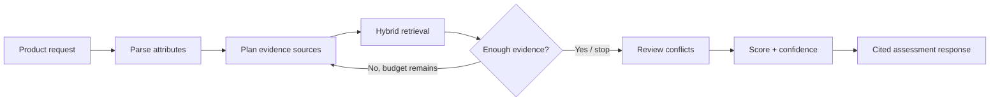
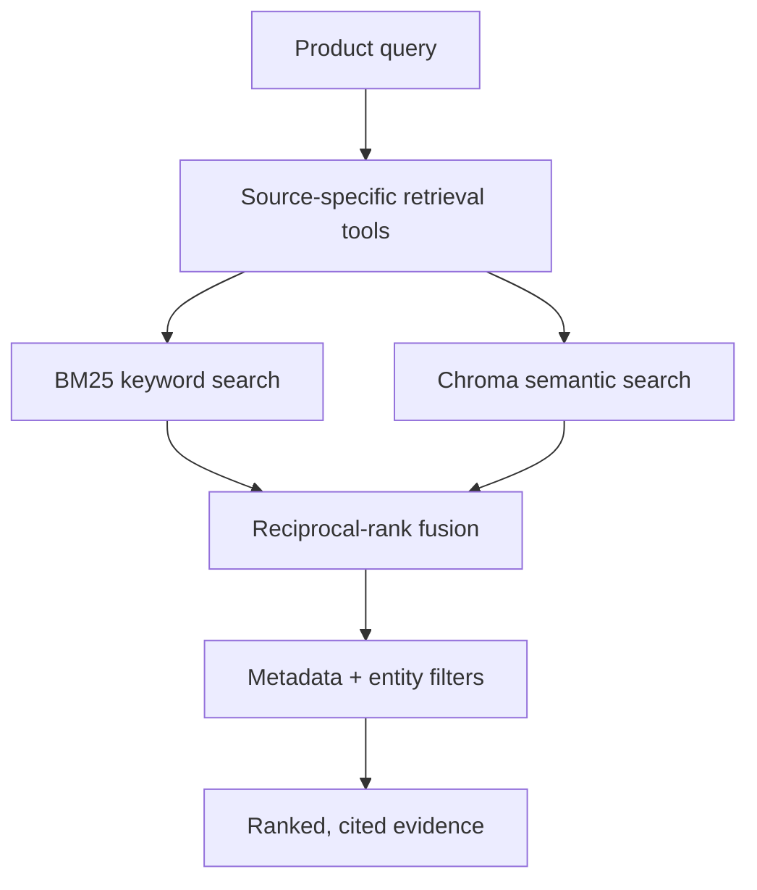

# AI Sustainability Assessment Agent

> **Evidence first. Claims second.**
>
> A local AI agent that assesses an apparel product from retrieved evidence, shows its sources, and clearly states uncertainty instead of guessing.

| Input | Processing | Output |
|---|---|---|
| Product description, brand, category, material | LangGraph + hybrid RAG + bounded Ollama | Cited evidence, scores, confidence, uncertainties, next actions |

---

## What problem does it solve?

Apparel sustainability information is fragmented. A product page may have a brand claim, while its material impact is described elsewhere and public criticism may tell a different story.

This project brings those signals into one response. It is **not** a lifecycle assessment or a certification engine. It is a transparent evidence-assessment agent: every conclusion is tied to retrieved local evidence or marked as uncertain.

---

## Run the project

```powershell
python -m venv .venv
.\.venv\Scripts\Activate.ps1
python -m pip install -r requirements.txt
python -m uvicorn src.main:app --host 127.0.0.1 --port 8000
```

Open interactive Swagger at `http://127.0.0.1:8000/docs`.

```json
{
  "query": "Levi's denim jeans",
  "brand": "Levi's",
  "category": "jeans",
  "materials": ["cotton", "denim"],
  "depth": "standard"
}
```

---

## Request-to-response flow



### What happens in each request?

| Step | Internal behavior | Why it matters |
|---|---|---|
| 1. Parse | Extracts brand, product category, material composition, and sustainability terms from the input. | Retrieval is targeted rather than a broad web-style search. |
| 2. Plan | Selects only the required source tools for `quick`, `standard`, or `deep` depth. | Keeps the workflow bounded and explainable. |
| 3. Retrieve | Searches official brand, material/certification, independent, and public-signal evidence. | Covers different kinds of claims instead of relying on one source. |
| 4. Check | Measures source-plan coverage; only retries missing evidence types and stops at the configured limit. | Prevents endless agent loops. |
| 5. Review | Detects possible cross-source disagreement, then asks Ollama to validate one pre-selected pair. | A keyword match alone is not treated as a true contradiction. |
| 6. Assess | Calculates rule-based dimension scores and confidence, validates citations, then returns grounded prose. | Scores and citations remain reproducible and defensible. |

---

## Assignment requirement coverage

| Requirement | How it is built |
|---|---|
| **Apparel sustainability problem** | The system accepts a consumer apparel product and returns an evidence profile across materials, brand commitments, certification/supply-chain signals, and public evidence. It never labels a product sustainable without support. |
| **Agent workflow** | LangGraph implements a stateful flow: parse → plan → retrieve → sufficiency check → bounded refinement → conflict review → scoring → synthesis. State preserves the plan, evidence, missing dimensions, trace events, and final response. |
| **RAG** | Sources are chunked with metadata. BM25 finds exact brand, material, and certification terms. Chroma finds semantic matches. Weighted reciprocal-rank fusion combines the two rankings. |
| **Local data storage** | `chunks.jsonl` keeps chunk text and provenance; `bm25.pkl` keeps the keyword index; Chroma persists embeddings. Stable chunk IDs preserve citations across API responses. |
| **Required source types** | The local corpus combines official sustainability/impact reports, material and certification references, independent evidence, and public-review/sentiment signals. The assignment demo uses versioned local snapshots, not live scraping. |
| **Source tools** | Brand, material, certification, and public-signal adapters query the hybrid index with category/entity metadata filters. This stops a generic source from being returned as the wrong evidence type. |
| **Decision strategies** | Rules choose tools, filters, budgets, retries, scores, and citations. Heuristics combine rank, authority, recency, source diversity, and evidence coverage. The LLM is limited to language interpretation. |
| **Ollama integration** | Ollama is called through its OpenAI-compatible endpoint for ambiguous attribute extraction, review of a pre-selected conflict pair, and grounded prose. Pydantic schemas and citation checks reject invalid model output. |
| **Grounding guardrails** | Unknown product composition makes material sustainability `not_assessable`; generic cotton/polyester evidence cannot generate a material score. An unvalidated conflict is an uncertainty, not a confirmed contradiction. |
| **Error handling** | Missing input attributes, empty evidence, a failed retrieval tool, and unavailable/invalid LLM output all produce a valid response with explicit uncertainties and safe fallbacks. |
| **Traceability** | Each evidence item includes a stable ID, snippet, URL, title, publisher, dates, category, credibility tier, and retrieval method. The response also returns an audit trace of the workflow decisions. |
| **API and validation** | FastAPI exposes typed request/response schemas and interactive Swagger. Empty or invalid requests are rejected by Pydantic validation. |
| **Evaluation** | The project includes automated unit/API tests, a 12-case evaluation set covering known/unknown brands, materials, ambiguity, certification wording, and conflict wording, plus raw request/response capture. |
| **1,000+ user design** | The production proposal separates stateless API replicas from queued LangGraph workers and adds caching, durable evidence/result storage, hybrid search, model routing, retries, and monitoring. |

---

## Retrieval and evidence model



| Evidence category | Typical question answered | Authority treatment |
|---|---|---|
| Brand | What progress, targets, or disclosures does the brand report? | Primary source, but still a company claim. |
| Material | What are the known impacts or preferred-production conditions for the declared material? | Technical/material reference. |
| Certification | What does a certification require and is product-level proof available? | Standard/reference; does not prove a product is certified by itself. |
| Independent/public | Are there external concerns, critiques, durability signals, or consumer experiences? | Qualitative and lower authority than primary evidence. |

> **Important:** The agent only scores a product material when the input actually supplies material composition. This prevents unrelated material research from becoming product evidence.

---

## What the API returns

```text
Product summary
├── cited evidence from the local corpus
├── dimension scores and overall score
├── confidence and source coverage
├── confirmed contradictions, if semantically validated
├── unresolved uncertainties
├── recommended next actions
└── audit trace of agent decisions
```

---

## Future enhancements

| Enhancement | Value |
|---|---|
| Live source connectors | Refresh approved brand reports, certification registries, and independent sources through controlled ingestion jobs. |
| Product-level data | Add retailer/product feeds with verified material composition, SKU, and certification identifiers. |
| Stronger evaluation | Add human-labelled relevance, grounding, conflict, and confidence-calibration benchmarks. |
| Feedback loop | Let reviewers flag weak retrieval or unsupported findings, then use those cases to improve the corpus and evaluation set. |
| Production scaling | Move local indexes to managed hybrid search, run deep assessments asynchronously, and add cache, queue, monitoring, and alerting infrastructure. |

## Design documents

- [Architecture](docs/ARCHITECTURE.md)
- [System design](docs/SYSTEM_DESIGN.md)
