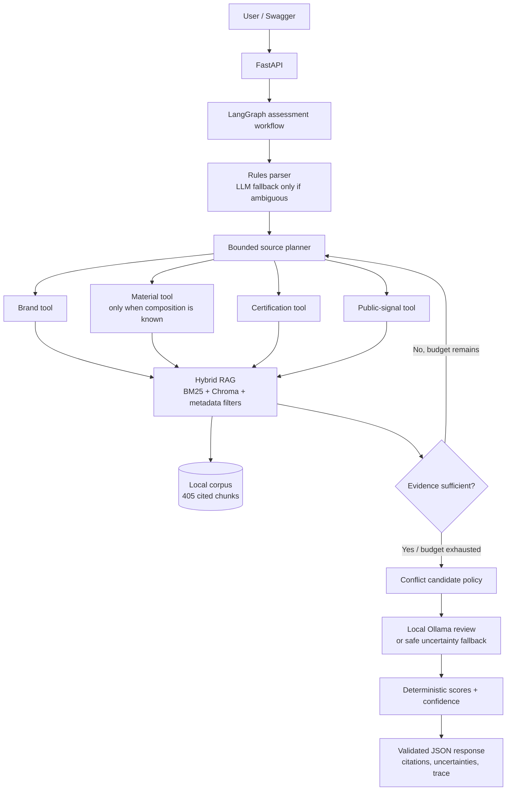

# Architecture

## Boundaries

- **Deterministic:** source selection, retrieval, metadata filters, retry limits, citation validation, scores, confidence, and API schema.
- **LLM-assisted:** ambiguous attribute extraction, review of one pre-selected conflict pair, and grounded wording of findings.
- **Safe behavior:** no material score without known composition; no confirmed contradiction without semantic validation; unavailable/invalid LLM output uses the deterministic response.

## Retrieval flow

The query is decomposed by evidence type. BM25 retrieves exact terms; Chroma retrieves semantic matches; weighted reciprocal-rank fusion combines them. Returned evidence carries source metadata and stable IDs so every response can show its receipts.
