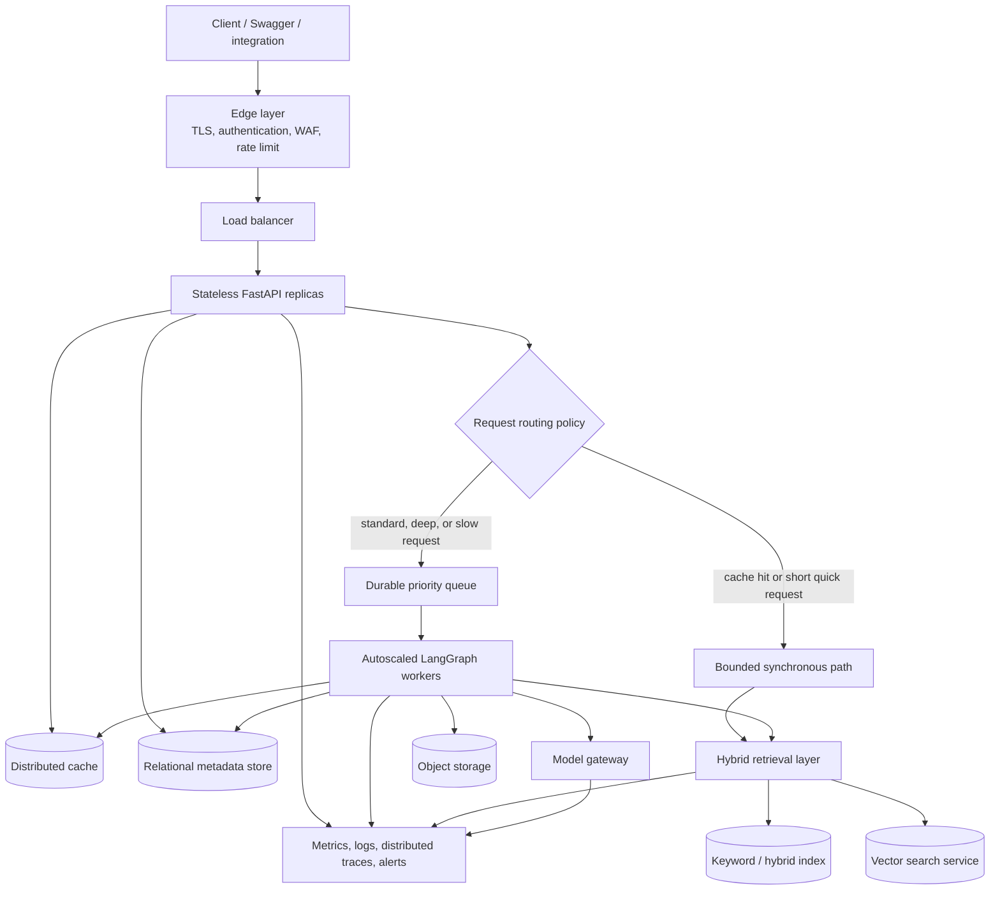
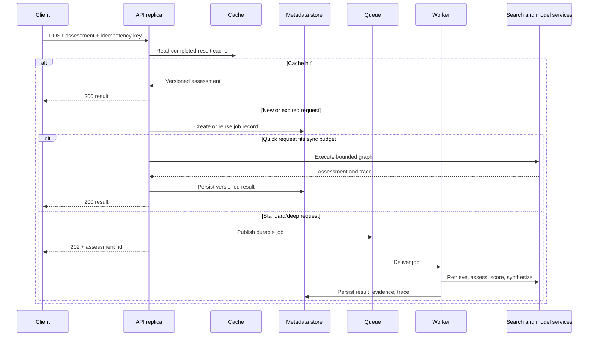
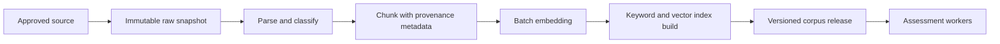

# Production System Design

## 1. Scope and design goals

The submitted implementation is a local FastAPI, LangGraph, BM25, Chroma, and Ollama application. This document describes how the same workflow can be operated for **1,000+ concurrent users** without changing its evidence-first behavior.

| Goal | Design implication |
|---|---|
| Evidence must be traceable | Keep immutable source snapshots, stable evidence IDs, corpus versions, and decision traces. |
| Deep requests can be slow | Separate short API work from queued background assessment work. |
| Load can be bursty | Use rate limits, cache, durable queues, worker autoscaling, and backpressure. |
| Search and model calls can fail | Use timeouts, bounded retries, circuit breakers, and partial responses with explicit uncertainty. |
| Costs must be bounded | Apply retrieval, context, model, retry, and concurrency budgets per assessment depth. |
| Results must be reproducible | Store corpus, policy, prompt/model, and code version identifiers with each assessment. |

The 1,000-user target requires load testing before capacity is chosen. Concurrent users alone does not specify request rate, corpus size, vector count, cache-hit rate, model latency, or required response-time objective.

---

## 2. Deployment model

The system uses **stateless API replicas**. An API replica is simply an identical FastAPI process running on a VM, container, Kubernetes pod, or serverless container. It does not keep durable job or session state in local memory/disk; shared state is held in external services. A load balancer can therefore route any request to any healthy replica and scale the API tier horizontally.

Long-running assessment execution is separated into worker replicas. API capacity and worker capacity can then scale independently: high request intake might require more API instances, while model/retrieval backlog might require more workers.

---

## 3. Request and job lifecycle

The asynchronous client contract includes `GET /assessments/{assessment_id}` for polling and may add a webhook callback for enterprise integrations. A request is idempotent: a retry with the same key returns the existing in-progress or completed job rather than duplicating model/search work.

---

## 4. Core services

| Capability | Responsibility | Required characteristics | Example service category |
|---|---|---|---|
| Edge layer | Protect and route incoming traffic. | TLS, authentication, WAF, per-user rate limits, request-size limits. | API gateway, reverse proxy, cloud load balancer. |
| API compute | Validate input, enforce budgets, serve cached results, create jobs. | Stateless, horizontally scalable, short-lived request handling. Public JSON API remains FastAPI/REST; internal high-volume service-to-service paths may use gRPC when profiling justifies it. | VM scale set, container platform, Kubernetes deployment, serverless container. |
| Queue | Decouple request intake from assessment throughput. | Durable messages, at-least-once delivery, retries, DLQ, priority support. | Managed queue/pub-sub or self-hosted message broker. |
| Workers | Execute the bounded LangGraph workflow. | Autoscaling, concurrency caps, idempotent writes, graceful shutdown/checkpoints. | Container or VM worker fleet. |
| Cache | Avoid repeat retrieval/model work. | TTL, eviction policy, availability, cache-key versioning. | Redis-compatible distributed cache. |
| Metadata store | Store jobs, users, idempotency keys, result metadata, and versions. | Transactions, backup/restore, indexes, audit retention. | PostgreSQL-compatible relational database. |
| Object store | Retain raw source snapshots, parsed files, chunks, traces, and backups. | Immutable/versioned objects, lifecycle retention, encryption. | S3-compatible/blob object storage. |
| Search layer | Return filtered keyword and semantic evidence. | Metadata filters, versioned indexes, predictable p95 latency, independent scaling. | Dedicated vector service plus search service, or hybrid-search platform. |
| Model gateway | Control LLM/embedding calls. | Timeouts, concurrency limits, model routing, structured-output validation, cost telemetry. | Managed inference endpoint, self-hosted inference server, or provider gateway. |

---

## 5. Retrieval and data design

### Controlled ingestion

The request path never scrapes the public internet. A separate ingestion pipeline refreshes approved sources and publishes an atomic, versioned corpus release.

Each chunk stores source URL, title, publisher, publication/capture date, source type, category, entity, credibility tier, and stable evidence ID. Each assessment records the corpus and policy version used to generate it.

### Vector-search strategy

The production search layer needs approximate nearest-neighbour search, metadata filters, high read concurrency, replication, shard-aware growth, online updates, backups, and observability. It should scale independently from the transactional result database.

A **dedicated vector-search service** is the stronger default for a growing RAG workload with many simultaneous filtered semantic queries. Suitable service categories include a managed vector-database tier or a self-hosted distributed vector cluster. Qdrant is one concrete example: its managed offering supports horizontal/vertical scaling, automatic shard rebalancing, resharding, high availability, monitoring, and backups; its self-hosted mode supports distributed deployment, sharding, and replication but requires more operational ownership.

### Why not pgvector if we are using PostgreSQL

pgvector should not be rejected as a universal rule. It is a good fit when the vector corpus is moderate, relational joins and transactional consistency are central, the team already operates PostgreSQL well, and a second data platform would create unnecessary operational cost.

For this workload, a dedicated vector service becomes preferable when semantic retrieval needs independent compute/storage scaling, high concurrent filtered ANN search competes with operational/result writes, or replica/shard management becomes a core availability requirement. pgvector supports HNSW and IVFFlat, but its documentation notes filtered approximate-search recall tradeoffs and describes horizontal scale through replicas or additional sharding tooling. That is a valid design, but it adds tuning and operational responsibility.

| Workload stage | Suitable search choice |
|---|---|
| Local assignment corpus and demo | Local Chroma is sufficient. |
| Moderate corpus, relational-first application, existing PostgreSQL expertise | PostgreSQL with pgvector can be appropriate. |
| Large or growing RAG corpus, high search concurrency, independent index scaling, shard/replica requirements | Dedicated vector-search service is the better default. |

---

## 6. Scaling, reliability, and degradation

| Scenario | System behavior |
|---|---|
| Traffic spike | Edge rate limits protect intake; queue absorbs durable work; workers scale from queue depth, queue age, and safe downstream capacity. |
| Duplicate submission | Idempotency key reuses the current job/result. Worker writes are idempotent because queues may deliver a message more than once. |
| Slow or unavailable model | Timeout, bounded retry, concurrency cap, and deterministic fallback. Deep work remains off the synchronous API path. |
| Source/search failure | Per-source timeout and circuit breaker; return remaining evidence with a missing-source uncertainty rather than inventing a conclusion. |
| Worker crash | Queue redelivery with exponential backoff; after the retry budget, route to a dead-letter queue for investigation. |
| Vector/index incident | Health checks, replica-aware routing, snapshot/restore, index-version rollback, and documented recovery test. |
| Bad corpus release | Publish immutable corpus versions; pin every result to one version; roll back by directing new jobs to the prior release. |
| Scaling downstream too quickly | Limit aggregate worker concurrency so autoscaling does not overload model/search/database dependencies. |

The queue is not only a scaling tool; it is a resilience boundary. It smooths bursts and protects expensive downstream dependencies. Workers must be bounded because unlimited consumers simply move overload from the API to search or model services.

---

## 7. Observability, security, and cost control

| Area | Signals and controls |
|---|---|
| API | Request rate, p50/p95/p99 latency, error rate, rate-limit events, cache-hit rate. |
| Queue/workers | Queue depth, oldest-message age, completion rate, retry rate, dead-letter count, worker saturation. |
| Retrieval quality | Empty-retrieval rate, evidence-category coverage, source freshness, citation validity, confidence distribution, contradiction rate. |
| Model operations | Latency, timeout/fallback rate, structured-output rejection rate, tokens/cost per depth, concurrent requests. |
| Security | Least-privilege identities, encrypted traffic/storage, managed secrets, source allowlist, audit logs, trace redaction, retention policy. |
| Cost | Depth-based budgets, cached hot results, batch embedding during ingestion, autoscaling ceilings, tiered object retention. |

Operational targets are agreed and validated through load tests: acknowledgement latency for queued jobs, p95 latency for quick/cached work, queue-age ceiling, citation-validity target, corpus-freshness target, and dependency-error budget.

---

## 8. Performance and cost policy

| Requirement | Production approach |
|---|---|
| Async retrieval | A worker fans out independent brand, material, certification, and public-signal retrieval calls concurrently with a fixed fan-out and per-call timeout. Dependent graph steps wait only for the required evidence groups. |
| Batching | Ingestion batches document parsing, chunk embedding, and index upserts. Model gateways may batch compatible embedding requests, but interactive assessment calls remain latency-bounded. |
| Hot-result cache | Cache normalized requests, completed assessments, and frequently reused brand/material retrieval results. Cache keys include corpus and policy version to prevent stale evidence from being mixed into a new release. |
| Reuse embeddings | Persist document/chunk embeddings during ingestion and recompute only changed chunks. Query embeddings are created once per assessment and shared by all semantic retrieval operations in that assessment. |
| Model routing | Route simple structured extraction and prose synthesis to a smaller/cheaper model; reserve more capable inference for bounded conflict interpretation or high-complexity cases. |
| Deep-analysis budgets | Deep requests have limits on source tools, top-k, retries, context size, model calls, timeout, and total job cost. They run through the queue rather than consuming unlimited synchronous API capacity. |
| Backpressure | Worker concurrency, queue limits, and gateway rate limits are set from measured downstream search/model capacity. This prevents autoscaling from overwhelming dependencies. |

---

## 9. Architecture decisions and rationale

| Decision | Rationale | Consequence |
|---|---|---|
| Keep API replicas stateless | Enables safe horizontal scaling and failure replacement behind a load balancer. | Durable state must live in shared services. |
| Queue standard/deep work | Prevents slow RAG/LLM work from exhausting HTTP capacity. | Requires job status API and idempotent worker design. |
| Version corpus and policies | Makes citations and assessments reproducible. | Requires release/rollback discipline. |
| Separate vector search from result metadata at scale | Allows search to scale and fail independently from transactional data. | Adds a data platform and ingestion synchronization. |
| Preserve deterministic scoring/citation validation | Keeps LLM output bounded and explainable. | Less flexibility than an unconstrained agent, but materially safer results. |

---

## References

- [Queue-based load leveling pattern](https://learn.microsoft.com/en-us/azure/architecture/patterns/queue-based-load-leveling) - durable queues, worker scaling, idempotency, DLQs, and downstream protection.
- [Autoscaling guidance](https://learn.microsoft.com/en-us/azure/architecture/best-practices/auto-scaling) - stateless horizontal scaling, queue-based scaling signals, and bounded downstream capacity.
- [AWS Well-Architected Framework](https://docs.aws.amazon.com/wellarchitected/latest/framework/) - reliability, security, performance, cost, and operational tradeoffs.
- [Qdrant managed cloud](https://qdrant.tech/documentation/cloud/) and [distributed deployment](https://qdrant.tech/documentation/distributed_deployment/) - managed/self-hosted sharding, replication, rebalancing, and scaling capabilities.

